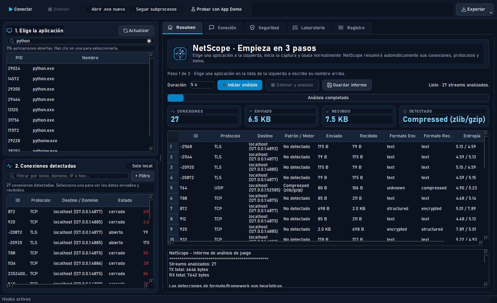
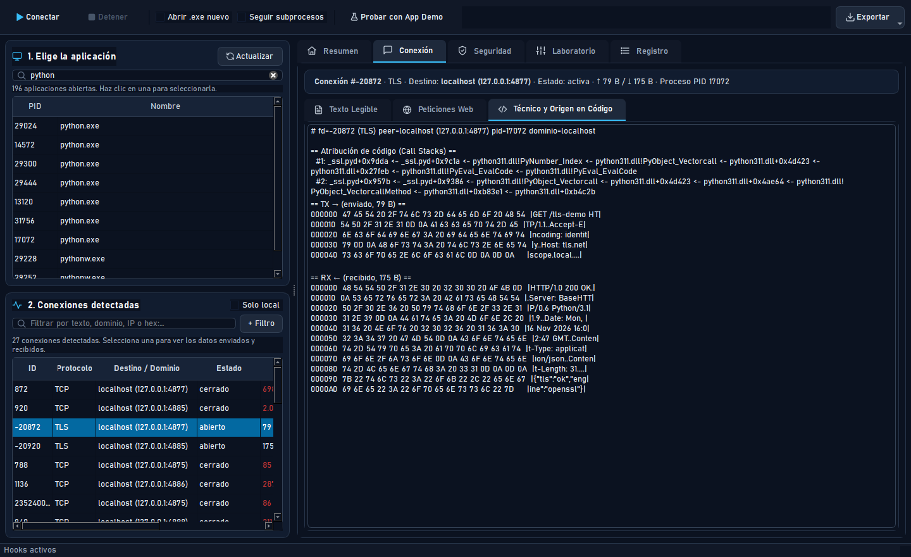
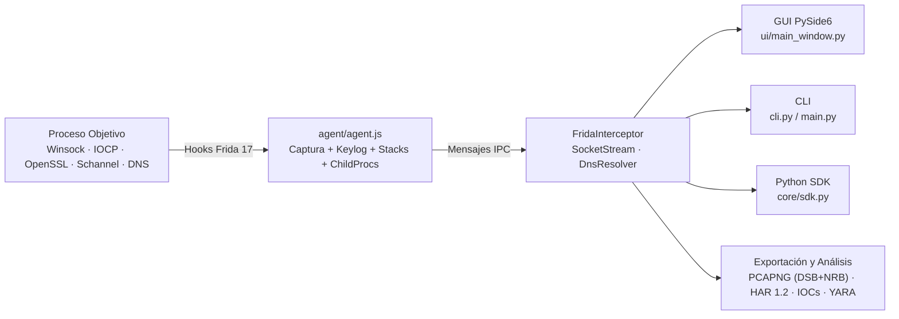

<div align="center">
  
  <h1>NetScope</h1>
  <p><strong>Instrumentación y observabilidad de red TCP / UDP / IOCP / TLS en tiempo real con Frida 17</strong></p>

  <p>
    
    
    
    
    <a href="LICENSE"></a>
    <a href="https://github.com/letox4/NetScope/actions/workflows/ci.yml"></a>
  </p>
</div>

---

**NetScope** es una suite de observabilidad y análisis de tráfico de red para Windows (**GUI en PySide6**, **CLI** y **SDK en Python**) impulsada por **Frida 17**. Permite adjuntarse a un proceso local —sin configurar proxies MITM ni certificados raíz— para inspeccionar tráfico TCP, UDP, Overlapped/IOCP, TLS en claro, atribución en código (call stacks), resolución DNS y artefactos forenses.

## Capturas

<table>
  <tr>
    <td width="50%">
      
      <p align="center"><em>Resumen de captura, métricas en vivo y análisis automático</em></p>
    </td>
    <td width="50%">
      
      <p align="center"><em>Inspección TLS en claro, hexdump y call stacks de código</em></p>
    </td>
  </tr>
</table>

---

## Arquitectura



---

## Características Principales

- **Winsock Síncrono y Asíncrono (Overlapped I/O + IOCP)**:
  - Intercepta `socket`, `WSASocketW`/`A`, `connect`, `WSAConnect`, `ConnectEx` (`WSAIoctl`), `closesocket`, `send`/`recv`, `sendto`/`recvfrom`, `WSASend`/`WSARecv` y `WSASendTo`/`WSARecvFrom`.
  - Consulta `getsockopt(SOL_SOCKET, SO_TYPE)` para clasificar sockets ya abiertos antes del attach y sigue operaciones diferidas (`WSA_IO_PENDING`) hasta `GetQueuedCompletionStatus`, `GetQueuedCompletionStatusEx`, `WSAGetOverlappedResult`, `GetOverlappedResult*` y rutinas APC (`lpCompletionRoutine`). Cubre aplicaciones nativas, .NET/Mono/IL2CPP, Node.js, Electron, Go y Chromium.
- **TLS en Claro (Schannel + OpenSSL/BoringSSL) y Exportación de Claves**:
  - Hooks sobre Schannel/SSPI (`EncryptMessage` / `DecryptMessage`) y OpenSSL/BoringSSL (`SSL_write*` / `SSL_read*`).
  - Extracción de secretos vía `SSL_CTX_set_keylog_callback` en formato `SSLKEYLOGFILE` o embebidos dentro del `.pcapng` (**Decryption Secrets Block**) para abrir la captura ya descifrada en Wireshark.
- **Atribución de Código (Call Stacks)**:
  - Registra `Thread.backtrace` + `DebugSymbol` (con RVAs limpios en binarios sin PDB) para saber exactamente qué módulo y función envió o recibió cada flujo.
- **Correlación IP ↔ Dominio**:
  - Une resoluciones `getaddrinfo`/`GetAddrInfoW`, cabeceras HTTP `Host`, TLS SNI, respuestas DNS UDP/53 y rDNS opcional, exportando bloques **NRB (Name Resolution Block)** en PCAPNG.
- **Seguimiento de Procesos Hijo**:
  - Opción **Seguir subprocesos** / `--follow-children` (Frida child gating + `CreateProcessW`/`A`) para capturar launchers, Electron o Chromium multi-proceso.
- **Exportación Estándar (PCAPNG y HAR 1.2)**:
  - `.pcapng` con enlaces Ethernet/IPv4/TCP-UDP sintetizados + `DSB` (claves TLS) + `NRB` (DNS).
  - `.har` (HTTP Archive 1.2) con pares petición/respuesta y metadatos de atribución.
- **Extracción de IOCs y Motor YARA**:
  - Detecta IPs, dominios, URLs, correos, cabeceras sensibles, hashes MD5/SHA-256 e indicadores heurísticos de C2.
  - Escáner YARA integrado (compatible con `yara-python` y motor nativo puro en Python), con reglas built-in y soporte para archivos `.yar`.
- **Observabilidad y Seguridad por Diseño (v1)**:
  - Inspector de memoria estrictamente en **solo lectura** (`VirtualQuery`, lectura de regiones, escalares, snapshots/diff ASLR-estables y watcher), sin escritura ni reserva de memoria desde la UI.
  - Panel de diagnóstico de protecciones (`core/antidebug/`) puramente informativo, sin técnicas de evasión.
- **CLI Completa, SDK y App Demo Propia**:
  - Subcomandos en `cli.py`, clase `NetScopeSession` en `core/sdk.py` y aplicación de demostración autocontenida (`demo_app.py`) para practicar sin software de terceros.

---

## Instalación y Requisitos

- **Sistema operativo**: Windows 10 / 11
- **Python**: 3.11+ (`py -3.11`)

```powershell
git clone https://github.com/letox4/NetScope.git
cd NetScope
py -3.11 -m pip install -r requirements.txt
```

> Ejecuta tu terminal o [NetScope.bat](NetScope.bat) **como Administrador** cuando necesites observar procesos con privilegios elevados.

---

## Uso Rápido

### 1. Interfaz Gráfica (GUI)

```powershell
py -3.11 main.py
```

También puedes abrirla con [NetScope.bat](NetScope.bat) y pulsar **Probar con App Demo** en la barra superior para lanzar la aplicación de pruebas propia y explorar todas las pestañas (**Resumen**, **Conexión**, **Seguridad**, **Laboratorio**, **Registro**).

### 2. Línea de Comandos (CLI)

```powershell
# Listar procesos activos
py -3.11 cli.py ps --filter python

# Capturar tráfico durante 15 s siguiendo procesos hijo y exportar resultados
py -3.11 cli.py capture --process "mi_app.exe" --duration 15 --follow-children `
    --pcapng captura.pcapng --har captura.har --keylog tls.keylog --extract-iocs --yara

# Análisis offline de archivos binarios o volcados con IOCs y YARA
py -3.11 cli.py scan payload.bin --json reporte.json

# Demo automatizada de extremo a extremo contra demo_app.py
py -3.11 cli.py demo --spawn-child
```

También puedes invocar cualquier subcomando directamente vía `py -3.11 main.py <subcomando>`.

### 3. SDK para tus Scripts (`core.sdk.NetScopeSession`)

```python
from core.sdk import NetScopeSession

with NetScopeSession(process="python.exe", follow_children=True) as ns:
    @ns.on_event
    def on_packet(ev):
        caller = ev.stack[0] if ev.stack else "?"
        print(f"[{ev.proto}] fd={ev.fd} {ev.direction} {len(ev.data)}B desde {caller}")

    ns.capture(duration=5.0)
    iocs = ns.extract_iocs()
    yara_hits = ns.scan_yara()
    ns.export_pcapng("captura.pcapng")   # Incluye claves TLS (DSB) y DNS (NRB)
    ns.export_har("captura.har")
    ns.export_keylog("tls.keylog")
```

### 4. Aplicación de Demostración Autocontenida

```powershell
# Interfaz de demostración (HTTP, Winsock IOCP, TLS OpenSSL, UDP, procesos hijo)
py -3.11 demo_app.py

# Ciclo único en modo consola
py -3.11 demo_app.py --once --spawn-child
```

---

## Estructura del Proyecto

| Ruta | Descripción |
|---|---|
| `main.py` | Punto de entrada unificado (GUI por defecto o CLI si recibe subcomandos). |
| `cli.py` | Interfaz de línea de comandos (`ps`, `capture`, `scan`, `demo`). |
| `demo_app.py` | Aplicación propia de prueba (Winsock IOCP, OpenSSL, HTTP, UDP y subprocesos). |
| `agent/agent.js` | Agente Frida 17 (Winsock + IOCP, TLS, DNS, call stacks y detección de hijos). |
| `agent/memory.js` | Agente RPC de inspección segura de memoria en solo lectura (`VirtualQuery`). |
| `core/interceptor.py` | Orquestador de sesión Frida, reconstrucción `SocketStream` y correlación. |
| `core/sdk.py` | API pública de scripting (`NetScopeSession`). |
| `core/dns_resolver.py` | Correlación IP ↔ dominio (hooks DNS, HTTP `Host`, TLS SNI, UDP/53 y rDNS). |
| `core/pcapng.py`, `core/har_exporter.py` | Exportadores PCAPNG (`DSB` + `NRB`) y HAR 1.2. |
| `core/threat_intel.py` | Extracción de IOCs (`IOCExtractor`) y motor YARA (`YaraScanner`). |
| `core/memory/`, `core/antidebug/` | Subsistema de memoria (solo lectura v1) y diagnóstico declarativo de protecciones. |
| `ui/` | Interfaz PySide6, assets SVG (`ui/assets/`) y cargador vectorial (`ui/icons.py`). |
| `examples.py`, `analyze_game.py` | Ejemplos de uso del SDK (`NetScopeSession`), decodificación y análisis de juegos. |
| `tests/` | Suite automatizada de pruebas con `pytest`. |

---

## Tests

```powershell
py -3.11 -m pytest -v
```

> **Uso ético**: NetScope está diseñado estrictamente para observabilidad de red, depuración e investigación autorizada de software propio o en entornos de laboratorio.

## Licencia

Distribuido bajo licencia [MIT](LICENSE).
